<p align="center">
  
</p>

<h3 align="center">
  <samp>
    &gt; Hi 👋, I'm
    <b><a href="https://dev-aria.com">Aria Aghakhani</a></b>
  </samp>
</h3>

<p align="center">
  <samp>「 A passionate front-end developer crafting Vue.js and Nuxt applications 」</samp>
</p>

<p align="center">
  <a href="https://dev-aria.com"></a>
  <a href="https://linkedin.com/in/aria-aghakhani"></a>
  <a href="https://instagram.com/dev.aria.agk"></a>
  <a href="mailto:contact@dev-aria.com"></a>
  <a href="https://komarev.com/ghpvc/?username=ariaaghakhani&label=Profile%20views&color=42B883&style=flat-square"></a>
</p>

<p align="center">
  
</p>

<p align="center">
  <a href="#-selected-work"><b>Projects</b></a>
  &nbsp;|&nbsp;
  <a href="#-technologies"><b>Technologies</b></a>
  &nbsp;|&nbsp;
  <a href="#-collaboration--contact"><b>Contact</b></a>
</p>

<p align="center">
  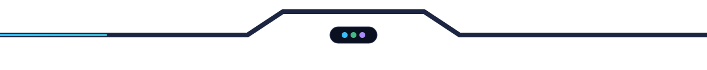
</p>

<p align="center">
  
</p>

<p align="center">
  <a href="#-selected-work">
    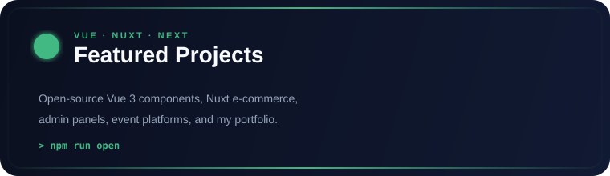
  </a>
</p>

<p align="center">
  <a href="#-technologies">
    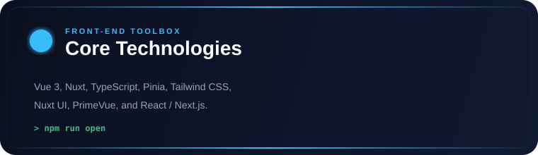
  </a>
  <a href="#aria-core">
    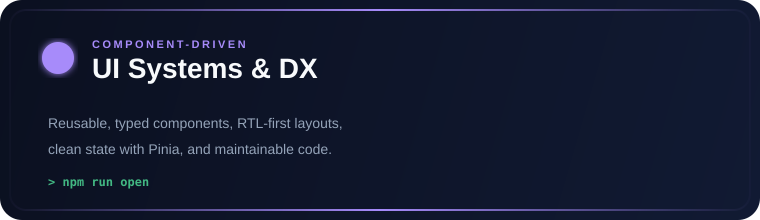
  </a>
  <a href="https://github.com/Ariaaghakhani/vue-jalali-datepicker">
    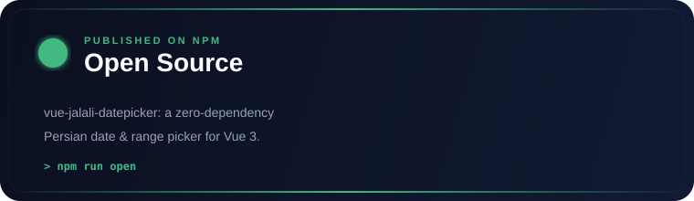
  </a>
</p>

<p align="center">
  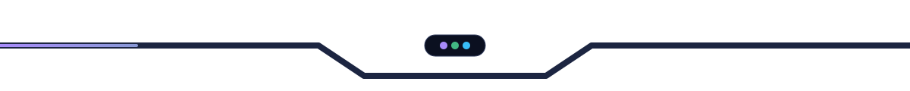
</p>

<p align="center" id="aria-core">
  
</p>

<p align="center">
  
</p>

## About

I'm **Aria Aghakhani**, a Front-End Developer with **4+ years** of experience building production web applications.

I work mostly with **Vue.js, Nuxt, TypeScript, JavaScript, Pinia, and Tailwind CSS**, and reach for **React and Next.js** when a project calls for it. I enjoy building reusable components, clean dashboards and admin panels, RTL-first interfaces, and UIs that stay fast and maintainable.

- 🌐 Portfolio: [dev-aria.com](https://dev-aria.com)
- 📦 Open source: [vue-jalali-datepicker](https://github.com/Ariaaghakhani/vue-jalali-datepicker) on npm
- 💬 Ask me about **Vue, Nuxt, React, Next, Tailwind, JavaScript, TypeScript**
- 📫 Reach me at **contact@dev-aria.com**

```ts
const aria = {
  role: "Front-End Developer",
  core: ["Vue", "Nuxt", "TypeScript", "JavaScript", "Pinia", "Tailwind CSS"],
  ui: ["Nuxt UI", "PrimeVue", "Vuetify", "Sass"],
  alsoUsing: ["React", "Next.js", "Node.js", "Firebase"],
  focus: ["component libraries", "dashboards", "RTL interfaces", "performance"],
};
```

<p align="center">
  
</p>

# 🛠 Technologies, Projects, and Domains

<table border="0" cellspacing="10" cellpadding="0">
<tr>
<td width="420" valign="top" align="center">

### 🛠 Technologies

<br/>

<table align="center" cellspacing="0" cellpadding="6">
  <tr>
    <td align="center"></td>
    <td align="center"></td>
    <td align="center"></td>
    <td align="center"></td>
    <td align="center"></td>
  </tr>
  <tr>
    <td align="center"></td>
    <td align="center"></td>
    <td align="center"></td>
    <td align="center"></td>
    <td align="center"></td>
  </tr>
  <tr>
    <td align="center"></td>
    <td align="center"></td>
    <td align="center"></td>
    <td align="center"></td>
    <td align="center"></td>
  </tr>
  <tr>
    <td align="center"></td>
    <td align="center"></td>
    <td align="center"></td>
    <td align="center" colspan="2"></td>
  </tr>
</table>

<p><sub>Core: Vue · Nuxt · TypeScript · Pinia · Tailwind<br/>Also: React · Next.js · Node.js · Firebase</sub></p>

</td>
<td width="260" valign="top" align="center">

### 🧪 Projects

<br/>

<a href="#-selected-work">
  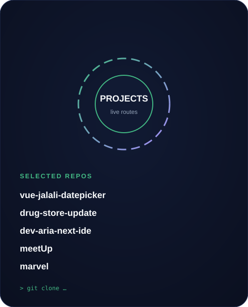
</a>

</td>
<td width="260" valign="top" align="center">

### 🧠 Domains

<br/>

<a href="#aria-core">
  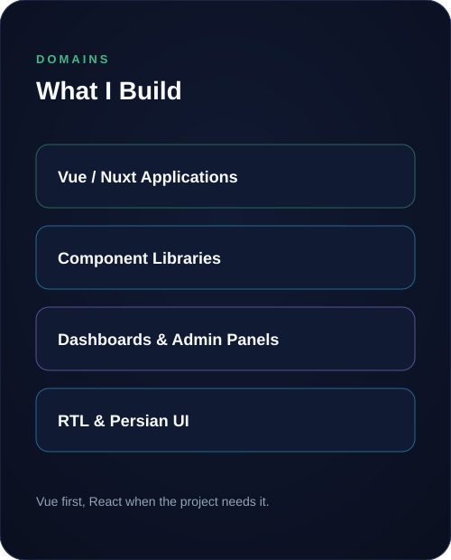
</a>

</td>
</tr>
</table>

<p align="center">
  
</p>

## 🚀 Selected Work

| Project | Stack | What it demonstrates |
| :--- | :--- | :--- |
| [vue-jalali-datepicker](https://github.com/Ariaaghakhani/vue-jalali-datepicker) | Vue 3 · TypeScript | Zero-dependency Persian (Jalali / Shamsi) date & range picker, RTL-first, themeable, published on npm. |
| [drug-store-update](https://github.com/Ariaaghakhani/drug-store-update) | Nuxt 3 · Nuxt UI · Pinia · Tailwind | Online pharmacy with catalog, cart, checkout, chat, and a role-based admin panel. |
| [dev-aria-next-ide](https://github.com/Ariaaghakhani/dev-aria-next-ide) | Next.js 15 · React · Tailwind · Firebase | My portfolio at [dev-aria.com](https://dev-aria.com): SEO-optimized, accessible, with a Firestore contact form. |
| [meetUp](https://github.com/Ariaaghakhani/meetUp) | Nuxt 3 · PrimeVue · Tailwind | Event platform for browsing, viewing, and hosting meetups. |
| [marvel](https://github.com/Ariaaghakhani/marvel) | Nuxt 3 · Pinia · PrimeVue | Marvel characters explorer with list and detail pages. |
| [fanava-website](https://github.com/Ariaaghakhani/fanava-website) | Nuxt 4 · Nuxt UI · Tailwind 4 | Company website built on the latest Nuxt stack. |

<p align="center">
  
</p>

### 📊 GitHub Stats

<div align="center">
  
  <br/>
  <a href="https://github.com/Ariaaghakhani">
    
  </a>
  <a href="https://github.com/Ariaaghakhani">
    
  </a>
  <br/>
  
</div>

<p align="center">
  
</p>

## 🐍 Contribution Snake

Generated by GitHub Actions from my contribution graph and published to the `output` branch.

<div align="center">
  <picture>
    <source media="(prefers-color-scheme: dark)" srcset="https://raw.githubusercontent.com/Ariaaghakhani/Ariaaghakhani/output/github-contribution-grid-snake-dark.svg" />
    <source media="(prefers-color-scheme: light)" srcset="https://raw.githubusercontent.com/Ariaaghakhani/Ariaaghakhani/output/github-contribution-grid-snake.svg" />
    
  </picture>
</div>

<p align="center">
  
</p>

## 🤝 Collaboration & Contact

<table border="0">
<tr>
<td width="340" valign="top">

### Collaboration

I'm interested in collaborating on:

- Vue.js / Nuxt product frontends
- Reusable component libraries
- Dashboards and admin panels
- Open-source Vue tooling

</td>
<td width="280" valign="top" align="center">

<a href="mailto:contact@dev-aria.com">
  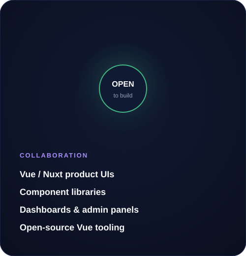
</a>

</td>
<td width="300" valign="top" align="center">

### Contact

<a href="https://dev-aria.com"></a>

<a href="https://linkedin.com/in/aria-aghakhani"></a>

<a href="https://instagram.com/dev.aria.agk"></a>

<a href="mailto:contact@dev-aria.com"></a>

</td>
</tr>
</table>

<p align="center">
  
</p>

### ☕ Support

<p align="center">
  <a href="https://www.buymeacoffee.com/r9hzw5fxqka">
    
  </a>
</p>

<p align="center">
  <samp>⚡ Building fast, reusable frontends with Vue, Nuxt, and TypeScript</samp>
</p>

<p align="center">
  
</p>
